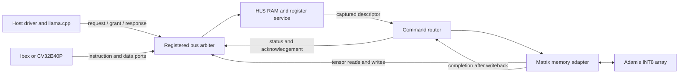

# HLS platform and partial Qwen co-execution

`rtl/soc_top.sv` connects an existing RISC-V core, an HLS-generated memory and
register service, the command router, and Adam Shebani's INT8 matrix array.
Device memory and register operations execute in RTL. The simulator's C++
driver loads firmware and tensors through the external host bus.

This is a functional hardware prototype. It does not implement full-model
inference, external DRAM, a host transport such as PCIe, interrupts, or a
banked SRAM architecture. Vector, recurrent-state and memory-command opcodes
continue to return `UNIMPLEMENTED`; their existing endpoints contain no C++
compute implementations to synthesize.



## Replaced device models

| Earlier simulation implementation | Hardware implementation |
|---|---|
| `SimHost::load` / `store` and its C++ RAM array | `hls/platform_memory.cpp`, synthesized into a 16,384-word RAM service |
| C++ instruction/data response scheduling | `rtl/platform_bus.sv`: registered grants, one outstanding service transaction, round-robin arbitration |
| `SimHost::read_bus` / `write_bus` | HLS register decoding, byte enables, bounds checks and explicit fault responses |
| Doorbell handling and descriptor reads in C++ | HLS validates and copies the 128-byte descriptor; RTL assembles and holds the command until accepted |
| `matrix_read_byte` / `matrix_write_word` DPI callbacks | Real matrix memory requests through the arbiter and HLS RAM |
| C++ monitoring counters | Host-side observations of RTL handshakes; these do not implement device behavior |

The earlier C++ platform remains available without `--hls` to reproduce dated
experiments. The HLS build excludes its memory model, DPI tensor callbacks and
simulation-only matrix adapter. C++ file loading, tokenization, quantization,
reference calculations and result checking remain host software.

## Build and run

Use licensed Linux with Synopsys VCS `Y-2026.03_Full64`, Python 3.11+, Make,
a C++17 compiler, and the existing firmware/llama.cpp prerequisites in
[SETUP.md](../SETUP.md). Verilator is used only for lint.

HLS requires [Bambu 2024.10](https://github.com/ferrandi/PandA-bambu/releases/tag/2024.10),
revision `c2ba6936ca2ed63137095fea0b630a1c66e20e63-main`. Its Linux x86-64
[AppImage](https://release.bambuhls.eu/bambu-2024.10.AppImage) is approximately
1.3 GiB. Verify SHA-256
`e4f0214496a5d35de1932975b0f41cd95bc33a53a904fc565d6c2cb01df40773`
and make it executable. Set `BAMBU` to its absolute path, or use an installed
`bambu` executable with the same version. Native AppImage execution requires
working FUSE; extracting the complete compiler bundle requires additional disk space.

```sh
./scripts/workspace.sh init
make deps model
make hls-check BAMBU=/absolute/path/to/bambu-2024.10.AppImage
make hls-workload-check BAMBU=/absolute/path/to/bambu-2024.10.AppImage
make hls-lint
make style
```

`make hls-check` generates RTL, checks its C++ contract against VCS, boots both
cores, and runs the matrix regression over 24 service-delay/grant configurations.
It also checks deliberately incorrect matrix results, invalid firmware and an
unknown active host-interface signal. `make hls-workload-check` runs Qwen with
hardware results and deliberately corrupts its reference on each core.

Regression scripts preserve existing evidence by requiring a fresh output
directory. For another run after building:

```sh
python3 scripts/check_matrix.py --hls --out build/hls-matrix-run2
python3 scripts/check_workload.py --out build/hls-workload-run2
python3 scripts/check_vcs_failures.py --hls --out build/hls-negative-run2
```

For an individual workload run:

```sh
python3 scripts/run_core.py ibex --hls --probe workload_probe \
  --model .deps/models/Qwen3.5-2B-Q4_K_M.gguf --out build/qwen-ibex-run2
```

Generated Verilog, initialization files, compiler logs and source/output hashes
live in `build/hls/platform/`. VCS builds and run records live in
`build/vcs-hls/<core>/<probe>/`. The build rejects stale HLS sources or modified
generated files. Runs check the simulator binary and copied initialization files.
Generated files retain Bambu's library attribution and license notices and are
not hand-edited or committed. The checked-in sources and pinned compiler regenerate them.

## Hardware behavior

- **Memory:** 64 KiB total. Firmware starts at `0x80`; the mailbox is at `0x2000`
  and the descriptor at `0x2100`. Tensors occupy `[0x3000, 0xf000)`; the stack
  occupies the final 4 KiB. Tests explicitly initialize memory through the host
  bus instead of depending on RAM power-up contents.
- **Registers:** the existing provisional `0x10000000` register window and
  descriptor encoding are retained. A doorbell validates the pointer, byte count,
  sequence and device availability before capturing the descriptor.
- **Arbitration:** instruction, data, matrix and host ports share one service.
  Grants are registered to avoid a request/grant combinational path through the
  CPU. All accepted transactions receive one response. Test delay inputs add
  response stalls and grant spacing; they are not estimates of a physical SRAM.
- **Matrix transfers:** the adapter reads bytes through the memory port, streams
  an A tile and one B column to the unchanged array, captures the complete C
  column, and writes each valid output word before advancing. This conservative
  schedule handles the array's lack of output backpressure. It is not a
  throughput-optimized DMA.
- **Reset and errors:** reset cancels commands and pending completions. Previously
  committed RAM writes remain. The HLS control-reset operation resets registers
  without erasing RAM. Invalid host accesses return an error. A CPU bus fault
  latches `cpu_fault_o` and holds the core in reset until the platform is reset;
  a CPU exception/interrupt path is not implemented.
- **Supported arithmetic:** test format `0xffff0001` uses signed INT8 operands
  and signed INT32 outputs, `1 <= M,K <= 8`, and `1 <= N <= 16`. Strides, bounds
  and output/input overlap are validated before tensor access. Proposed INT4
  formats remain unsupported.

For synthesis, use `soc_top` with the same pinned core and generated HLS sources
listed by `scripts/build_core.py --hls`. The inferred RAMs still need target
memory mapping, timing constraints and physical implementation. HLS generation
and VCS elaboration are not an area, timing or power signoff.

## What the Qwen check proves

`sim/workload_probe.cpp` loads the pinned Qwen3.5-2B Q4_K_M GGUF. It processes a
seven-token prompt and then one generated token. In each stage it selects the
first eligible matrix projection and computes its first eight output channels
through the device across the complete 2,048-element input dimension.

Actual model weights and activations are converted to symmetric INT8 using one
scale per weight row and activation vector. This is a test conversion, not the
GGUF's original arithmetic or an accepted model quantization scheme. The host
tiles the operands, submits commands to RISC-V firmware, reads hardware INT32
partial sums, combines them and applies the scales.

The returned values replace the selected ggml projection outputs **before
downstream graph nodes execute**. The current hook still lets llama.cpp compute
the original projection first, so this is numerical co-execution rather than
a production backend or a speedup measurement.

Three inference runs distinguish the checks:

1. Original llama.cpp execution measures the effect of the test conversion.
2. A scalar INT8 reference replaces the same projection outputs in software.
3. The hardware path replaces them using values returned by the SoC.

Every hardware integer output is checked against an independent scalar dot
product. Prefill and decode logits are compared between runs 2 and 3. A nonzero
difference between runs 1 and 2 confirms that the replaced outputs affect the
model. This does **not** establish original-model accuracy, full hardware
inference, or support for vector/recurrent operations.

See the [dated validation report](../experiments/2026-10-13-hls-platform/README.md)
for measured results. Code, functional and assertion coverage are reported
separately from directed test counts.
